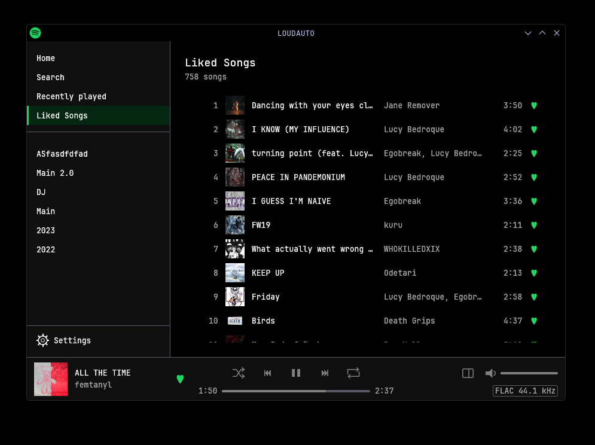

# LOUDAUTO

A small, fast Spotify player for Linux, written in Rust. Playback is Spotify's own, lossless
where your account has it, through [Spotify Soloist](https://developer.spotify.com/documentation/soloist).
Around it are a native window, a background engine that keeps playing when the window is closed,
and a command line.



> [!IMPORTANT]
> **You need Spotify Premium.** Spotify only issues Soloist API keys to Premium accounts, and
> LOUDAUTO can't play anything without one. The key is free and you make it yourself in a minute
> ([step 2](#2-get-your-soloist-api-key)).

> [!WARNING]
> **LOUDAUTO doesn't include Spotify Soloist, the program that actually plays the music.**
> Spotify asks developers not to redistribute Soloist's archives or binaries, so it isn't in this
> repository, in any release, or compiled into anything here. Instead, the installer downloads it
> **straight from Spotify** onto your own machine, from the same URL Spotify's
> [Downloads and updates](https://developer.spotify.com/documentation/soloist/reference/downloads-and-updates)
> page links to. A weekly timer keeps it fresh ([why](#keeping-soloist-up-to-date)).

## Features

- **Spotify's own playback.** Soloist decrypts and plays the audio into PipeWire; LOUDAUTO only
  tells it what to play. Quality is pinned to lossless (FLAC), and the bottom bar shows what's
  actually streaming.
- **Your library:** Home, Search, Recently played, Liked Songs, your playlists, and album and
  artist pages, with covers.
- **The player:** play/pause, previous/next, seek, shuffle, repeat, volume and the heart. A side
  panel holds the queue, lyrics (synced ones follow the song) and credits.
- **Lives in the background:** the engine (`loudautod`) keeps playing with the window closed,
  with a tray icon, MPRIS (media keys, Plasma's media widget and the lock screen), notifications
  and an optional start at login.
- **Spotify Connect:** LOUDAUTO shows up in your other Spotify apps' device list. When another
  device is playing, the window, the tray and the media keys show and control that device.
- **A global "like" key** through the desktop portal (it suggests Meta+Shift+H).
- **Pick the output:** play into any PipeWire sink, for example an equalizer like Easy Effects.
- **`loudauto-cli`** to browse your library from a terminal, like the playing song, and manage
  the keys and login.

## Benchmark: LOUDAUTO vs Spotify's official app

Both clients on the same desktop, playing the same song at the same (lossless) quality, measured
the same way. These are medians of 5 runs per client, with the range across runs in brackets.

| | LOUDAUTO | Spotify (official) | |
|---|---:|---:|---|
| **Launch to window on screen** | **0.37 s** <sub>(0.09–1.14)</sub> | 1.58 s <sub>(0.94–3.98)</sub> | 4.2× faster |
| **Memory, idle** (PSS, all processes) | **180 MB** <sub>(163–181)</sub> | 1,164 MB <sub>(1,084–1,218)</sub> | 6.5× less |
| **Memory, playing** | **188 MB** <sub>(186–189)</sub> | 1,012 MB <sub>(941–1,090)</sub> | 5.4× less |
| **CPU, idle** with the window open | **0.6 %** <sub>(0.5–1.0)</sub> | 4.3 % <sub>(3.2–11.5)</sub> | 7.2× less |
| **CPU, playing** with the window open | **1.2 %** <sub>(1.1–1.9)</sub> | 3.2 % <sub>(2.8–29.6)</sub> | 2.6× less |
| **Processes / threads** | **4 / 42** | 10 / 166 | |
| **Disk** (installed files) | **109 MB** | 405 MB | 3.7× less |

CPU is a percentage of one core (the machine has 16 threads). LOUDAUTO's numbers always include
everything it runs: the window, the engine and both of Soloist's processes. Its 109 MB on disk is
72 MB of LOUDAUTO (window, engine, CLI) and 36 MB of Soloist.

<details>
<summary><b>How it was measured</b></summary>

- **The machine:** Intel Core i5-12600K, 64 GB of RAM, Arch Linux (kernel 7.2.11), KDE Plasma
  6.8.2 on Wayland, PipeWire 1.6.10. Measured on 2026-11-09.
- **What against what:**
  - LOUDAUTO at commit `d0f9afb` with Soloist 1.3.10.55 (built 2026-11-09), installed by
    `scripts/install.sh`.
  - Spotify's official Linux client 1.3.4.258, installed by `spotify-launcher` and run with the
    flags its config adds. On this machine that means natively on Wayland, so both run as native
    Wayland windows.
  - Both are logged in to the same Premium account and set to lossless (Soloist's lossless
    setting, and Spotify's top streaming quality). Caches were warm.
- **The script:** [`bench/bench.py`](bench/bench.py) runs everything; the raw numbers are in
  [`bench/results/2026-11-09.json`](bench/results/2026-11-09.json). It alternates the clients
  run by run, so slow drift on the machine hits both the same. Each client gets a warm-up run that
  isn't counted, then 5 counted runs. Each run:
  1. **Close everything** the client runs.
  2. **Start** the client the way a user would: Spotify's binary, or LOUDAUTO's window, which
     starts its engine. **Startup** is the time from launch until KWin maps the client's window,
     as logged by a small KWin script that timestamps every new window. It doesn't measure when
     the content inside the window finishes loading.
  3. **Wait 20 s, then take memory:** PSS (proportional set size: memory shared between
     processes is split between them, so nothing is counted twice), summed over every process
     whose executable belongs to the client. Spotify counts as everything under its install
     folder; LOUDAUTO as `loudauto`, `loudautod` and `soloist`.
  4. **Idle CPU:** the processes' user + system time over 30 s, with the window open and
     nothing playing.
  5. **Playing** (the first 3 counted runs): play *nine (feat. Lucy Bedroque)* by Egobreak,
     prettifun and Lucy Bedroque, through MPRIS for Spotify and the engine's socket for
     LOUDAUTO. Wait 10 s, then take CPU over 60 s and memory at the end.
- **Nothing is heard.** A temporary PipeWire null sink is made the default output, and both
  clients are pointed at it. Easy Effects is quit for the run, since it would move streams to its
  own sink. The script checks that every new stream lands on the null sink, and stops at once if
  one doesn't. Everything is put back afterwards: the default sink, Easy Effects, LOUDAUTO's
  settings and the KWin script.
- **One outlier:** one of Spotify's playing runs averaged 29.6 % CPU over its minute. The median
  keeps it from skewing the table; the range shows it.
- **Not measured:** GPU use, power, network traffic, and how long each client takes to fill its
  window with content.

Run it yourself (KDE Plasma on Wayland with PipeWire, both clients installed and logged in). It
takes over your account's playback for about 20 minutes:

```sh
python3 bench/bench.py --track spotify:track:<id> --runs 5 --play-runs 3 --out bench/results/mine.json
```

</details>

## How it works

```text
 loudauto (the window, egui)  ─┐
 loudauto-cli                 ─┼─ engine-ipc ─ loudautod (the engine) ─┬─ Spotify Soloist ─ PipeWire
 tray · MPRIS · global key    ─┘  Unix socket                          │  (child process,
                                                                       │   local WebSocket API)
                                                                       └─ librespot + Spotify's web API
                                                                          (your library and pages,
                                                                           never audio)
```

- **`loudautod` owns everything.** It runs Soloist as a child process and drives it over
  Soloist's local WebSocket API. It holds the Spotify session and caches, and serves the window,
  the CLI and the desktop through one small protocol over a Unix socket
  (`$XDG_RUNTIME_DIR/loudauto/engine.sock`). Closing the window changes nothing about playback.
- **Audio never passes through LOUDAUTO.** Soloist does the decryption and plays straight to
  PipeWire. This project never touches decrypted audio and never works around Spotify's DRM.
- **Metadata comes from [librespot](https://github.com/librespot-org/librespot)** (an
  open-source Spotify client library) and Spotify's web API: playlists, Liked Songs, search,
  Home, lyrics and credits.
- **Secrets live in your desktop keyring** (the Secret Service: KWallet on Plasma, GNOME Keyring
  elsewhere): your Spotify login, and your Soloist API key.

| Crate | What it is |
|---|---|
| [`crates/app`](crates/app) | `loudauto`, the window (egui), a client of the engine |
| [`crates/engine`](crates/engine) | `loudautod`: playback, the session, MPRIS, the tray, notifications, the global key |
| [`crates/engine-ipc`](crates/engine-ipc) | The protocol between the engine and its clients, and the client |
| [`crates/playback`](crates/playback) | Runs and supervises Soloist and speaks its WebSocket API |
| [`crates/spot-core`](crates/spot-core) | The Spotify session (librespot), the library and the web API's pages |
| [`crates/spot-cli`](crates/spot-cli) | `loudauto-cli` |
| [`crates/icon-theme`](crates/icon-theme) | Finds the desktop's icons for the tray and the window |

## Setup

Tested on Arch Linux with KDE Plasma 6 (Wayland). Other desktops with PipeWire and a
Secret Service keyring should work.

### 1. What you need

- **Spotify Premium.**
- **Linux on x86_64 or arm64**, the architectures Spotify builds Soloist for.
- **PipeWire.**
- **A Secret Service keyring**: KWallet on Plasma, GNOME Keyring on GNOME and most others.
- **Rust 1.95 or newer** ([rustup](https://rustup.rs)), a C toolchain, `pkg-config`, OpenSSL's
  headers, `curl` and `jq`:

  ```sh
  sudo pacman -S --needed base-devel pkg-config openssl curl jq                  # Arch
  sudo apt install build-essential pkg-config libssl-dev curl jq                 # Debian, Ubuntu
  ```

- *Optional:* a CJK font (`noto-fonts-cjk`) for Japanese, Chinese and Korean titles.

### 2. Get your Soloist API key

1. Sign in to the [Spotify for Developers dashboard](https://developer.spotify.com/dashboard/soloist)
   **with your Premium account**.
2. Open **Spotify Soloist API Key** and generate a key. Keep the page open for step 4.

> [!CAUTION]
> **The key is yours alone.** Spotify's terms say each user generates their own key and must not
> share it. Never paste it into an issue or a commit. LOUDAUTO keeps it only in your keyring.

### 3. Build and install

```sh
git clone https://github.com/dannycake/loudauto.git
cd loudauto
./scripts/install.sh
```

`install.sh` does all of this, for your user only (no root):

- builds a release and installs `loudauto`, `loudautod`, `loudauto-cli` and
  `loudauto-update-soloist` into `~/.local/bin` (make sure it's on your `PATH`);
- installs the desktop entry and the systemd user units;
- **downloads Soloist from Spotify** into `~/.local/share/loudauto/soloist/`;
- enables `loudauto-soloist-update.timer`, which checks for a newer Soloist every week.

Run it again any time to update LOUDAUTO itself.

### 4. Save your key

```sh
loudauto-cli set-key
```

Paste the key and press Enter. It isn't shown as you paste, and it goes into your keyring.

Other ways to supply the key:
- **Environment variable:** set `SOLOIST_API_KEY`. It wins over everything else and is never
  saved.
- **1Password:** set `LOUDAUTO_SOLOIST_OP_REF` to an `op://vault/item/field` reference. It's read
  with the `op` CLI when the keyring has no key, then kept in the keyring.

### 5. Log in and pair

1. Open **LOUDAUTO** from your app menu, or run `loudauto`.
2. Click **Log in**. You'll see a link and a code: approve it from any browser or phone. The
   login is kept in your keyring. (`loudauto-cli login` does the same in a terminal.)
3. **First time only:** pair Soloist. Open the Spotify app on this PC and pick **LOUDAUTO** in its
   device list. Soloist remembers the pairing.

> [!TIP]
> Pairing works from any Spotify app on the same network, but a firewall that blocks the local
> network will hide LOUDAUTO from your phone. Pairing from the Spotify app on the same PC always
> works.

That's it: your library is in the window, and the music is Spotify's own.

## Keeping Soloist up to date

> [!WARNING]
> **Soloist builds expire 90 days after Spotify builds them,** and an expired build refuses to
> start (exit code 10). The clock starts at Spotify's build date, not the day you downloaded it.
> A build fetched today may already be weeks old. So LOUDAUTO checks **every week**, not every 90
> days.

- **`loudauto-soloist-update.timer`** runs `loudauto-update-soloist` weekly. It asks Spotify
  whether the build changed (the archive's ETag) and downloads only when there's a newer one. It
  checks that the new build runs, then swaps it in, all in your data folder.
- The running player keeps the old build until LOUDAUTO next starts Soloist. To switch at once:
  `systemctl --user restart loudauto.service`.
- **The window warns you** 14 days before the installed build expires. If it ever does expire,
  it says so with the command to fix it.

```sh
loudauto-update-soloist             # check now, download if there's a newer build
loudauto-update-soloist --force     # download again regardless
systemctl --user list-timers loudauto-soloist-update.timer
~/.local/share/loudauto/soloist/soloist --version   # the build date is the (YYYYMMDD)
```

> [!NOTE]
> The script only ever talks to `soloist-builds.spotifycdn.com`, Spotify's own download server. It
> keeps Spotify's `THIRD_PARTY_LICENSES.txt` and `CHANGELOG.md` beside the binary. Prefer doing it
> by hand? Download the archive for your architecture from Spotify's
> [Downloads and updates](https://developer.spotify.com/documentation/soloist/reference/downloads-and-updates)
> page and put the `soloist` executable at `~/.local/share/loudauto/soloist/soloist` (or point
> `LOUDAUTO_SOLOIST_BIN` at it).

## Using it

**Settings** (the gear at the bottom of the sidebar) pick the output device and start at login,
and can forget the saved Soloist key.

The command line:

```sh
loudauto-cli login | logout                 # the Spotify login (logout --soloist also unpairs Soloist)
loudauto-cli set-key | forget-key           # the Soloist API key in your keyring
loudauto-cli heart                          # like or unlike what's playing (bind it to a key)
loudauto-cli playlists
loudauto-cli ls spotify:playlist:<id> --limit 10
loudauto-cli liked --limit 10
loudauto-cli search lucy bedroque
loudauto-cli lyrics spotify:track:<id>
```

`loudauto-cli player` and `loudauto-cli ctl …` run and control Soloist without the engine, for
poking at Soloist directly.

**Where things live:**

| What | Where |
|---|---|
| Soloist (downloaded) | `~/.local/share/loudauto/soloist/` |
| Soloist's pairing and state | `~/.local/share/loudauto/soloist-data/` |
| Soloist's log | `~/.cache/loudauto/soloist/soloist.log` (the run before: `soloist.log.1`) |
| Caches (covers, pages) | `~/.cache/loudauto/` |
| Settings | `~/.config/loudauto/settings.json` |
| Login and API key | your keyring, under "LOUDAUTO" |
| Engine | `systemctl --user status loudauto.service` |

## Troubleshooting

- **"Spotify Soloist isn't installed" or "This Soloist build has expired":** run
  `loudauto-update-soloist`, then click **Try again**.
- **"No Soloist API key":** `loudauto-cli set-key`.
- **LOUDAUTO isn't in the Spotify app's device list:** pair from the Spotify app on the same PC,
  or let your firewall allow the local network.
- **Login or key won't save:** make sure a Secret Service keyring is running and unlocked
  (KWallet or GNOME Keyring).
- **Boxes instead of Japanese, Chinese or Korean titles:** install a CJK font.
- **Something else:** Soloist's log (above) and `journalctl --user -u loudauto.service`.

## Development

```sh
cargo test --workspace                     # offline: no account, no Soloist
cargo clippy --workspace --all-targets -- -D warnings
LOUDAUTO_LIVE=1 cargo test -p spot-core --test live -- --test-threads=1   # live, after logging in
```

## Not affiliated with Spotify

> [!NOTE]
> LOUDAUTO is an unofficial, personal project, not made, endorsed or supported by Spotify.
> Spotify and Soloist are Spotify AB's. Use it under Spotify's
> [Developer Terms](https://developer.spotify.com/terms) and your own account's terms. Soloist
> stays Spotify's software under Spotify's terms; this project only downloads it for you from
> Spotify and runs it.

## License

LOUDAUTO's own code is [MIT](LICENSE). Soloist is not part of it; its third-party notices come with
the download (`THIRD_PARTY_LICENSES.txt`).
